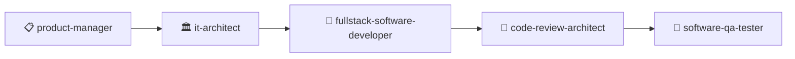
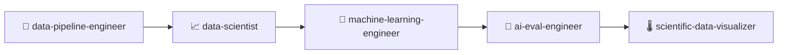

<a id="top"></a>

<div align="center">

# 🎭 Agent Characters

### 80 structured AI personas, operating workflows & system prompts — in one place


[](LICENSE)

**Hi, I'm Adarsh 👋**

Short `"act as X"` prompts fall apart fast once a task gets real. This repo holds
my collection of **80 full character specs** (`74` built up from `prompt.json` +
`6` original ones) stored cleanly at `character/<slug>/<slug>.md` with clear
workflows, rules, I/O contracts, copy-paste system prompts, and sample runs. 🚀

<p>
  <a href="#start-here">Start Here</a>
  &nbsp;·&nbsp;
  <a href="#structure">Structure</a>
  &nbsp;·&nbsp;
  <a href="#modes">Modes</a>
  &nbsp;·&nbsp;
  <a href="#collection">Collection</a>
  &nbsp;·&nbsp;
  <a href="#run">Use Locally</a>
  &nbsp;·&nbsp;
  <a href="#safety">Safety</a>
</p>

</div>

---

<a id="start-here"></a>

## ✨ Start Here

<div align="center">

| 📁 Path | 📝 What's Inside |
| :--- | :--- |
| 📂 **[`categories/`](./categories/README.md)** | All 8 domain indexes (`engineering`, `data-ai`, `writing-content`, `education-research`, `business-career`, `creative-media`, `health-lifestyle`, `interactive-personas`) |
| 🎭 **[`character/<slug>/`](./character/linux-terminal/linux-terminal.md)** | 80 individual Markdown blueprints with YAML metadata, system prompts & working examples |
| 📦 **[`characters.json`](./characters.json)** | Single JSON file indexing every character, category, pairing, and system prompt for scripts & APIs |

</div>

> 💡 **My rule for prompts:** an agent shouldn't guess how to behave when edge cases hit. Give it a clear workflow, explicit don'ts, and a strict output contract. 🔥

---

<a id="structure"></a>

## 🗺️ Inside Each Character

Every character file follows the same 9-part layout:

```text
🏷️ Frontmatter    →  slug · category · interaction_mode · tags · version
🎭 Persona        →  role · mental model · voice calibration
⚡ Capabilities   →  4+ concrete tasks and problem types it handles
🔄 Workflow       →  step-by-step execution loop from input to reply
🛡️ Guardrails     →  explicit do's, don'ts & domain safety limits
🔌 I/O Protocol   →  expected inputs · output shape · turn memory
📋 System Prompt  →  ready to copy-paste + collapsible original prompt.json reference
💬 Sample Run     →  realistic user message + verified character response
🔗 Pairings       →  companion characters to hand work off to next
```

### Before and after

**Before (`prompt.json` one-liner):**

> I want you to act as a linux terminal. I will type commands and you will reply with what the terminal should show. I want you to only reply with the terminal output inside one unique code block, and nothing else.

**After ([`character/linux-terminal/linux-terminal.md`](./character/linux-terminal/linux-terminal.md)):**

> Gives the model an explicit `Ubuntu 24.04` bash state model (`pwd`, files, permissions, environment variables), GNU coreutils column formatting rules, realistic `stderr` errors (`command not found`, `Permission denied`), `{curly brace}` out-of-band simulator directives, strict single-code-block output checks, a clean system prompt, and a sample session.

<details>
  <summary><strong>Preview YAML frontmatter (<code>character/code-review-architect/code-review-architect.md</code>)</strong></summary>

```yaml
---
slug: code-review-architect
name: "Code Review & Refactoring Architect"
category: engineering
category_label: "Engineering & Technical Systems"
source: "custom"
original_title: "Custom Original"
interaction_mode: "structured-deliverable"
tags: ["code-review", "refactoring", "architecture", "security", "maintainability"]
version: "1.0.0"
---
```

</details>

---

<a id="modes"></a>

## 🎭 Interaction Modes

Each character declares one of four interaction modes so you know how it replies before pasting the prompt:

| Mode | Count | What to expect | Examples |
| :--- | :---: | :--- | :--- |
| `structured-deliverable` | `51` | Clean specs, PR reviews, tables, essays, and structured plans | [Code Review Architect](./character/code-review-architect/code-review-architect.md), [Product Manager](./character/product-manager/product-manager.md), [AI Eval Engineer](./character/ai-eval-engineer/ai-eval-engineer.md) |
| `strict-output` | `17` | Raw tool, code, game, or translation output with zero chatter outside | [Linux Terminal](./character/linux-terminal/linux-terminal.md), [SQL Terminal](./character/sql-terminal/sql-terminal.md), [Chess Player](./character/chess-player/chess-player.md) |
| `conversational` | `6` | Back-and-forth coaching, tutoring, critique, or strategy dialogue | [J.A.R.V.I.S.](./character/jarvis/jarvis.md), [Algorithm Instructor](./character/algorithm-instructor/algorithm-instructor.md), [Career Counselor](./character/career-counselor/career-counselor.md) |
| `interactive-loop` | `6` | Turn-by-turn quizzes, step-by-step tutoring, and RPG sessions | [MathBot](./character/mathbot/mathbot.md), [Kanji Quiz Tutor](./character/japanese-kanji-quiz-machine/japanese-kanji-quiz-machine.md), [Tabletop RPG DM](./character/dnd-dungeon-master/dnd-dungeon-master.md) |

---

## 🔄 How Characters Chain Together

Every character lists companion pairings in Section 8 so you can pass outputs cleanly from one role to the next:





- **Ship software**: `product-manager` -> `it-architect` -> `ux-ui-developer` -> `fullstack-software-developer` -> `code-review-architect` -> `software-qa-tester` -> `devops-sre-engineer`
- **Build data & ML**: `data-pipeline-engineer` -> `data-scientist` -> `machine-learning-engineer` -> `ai-eval-engineer` -> `scientific-data-visualizer`
- **Research & write**: `academician` -> `essay-writer` -> `proofreader` -> `english-translator-and-improver` -> `seo-strategist`

---

<a id="collection"></a>

## 📚 My Character Collection

### 🧭 8 Domains at a Glance

| Category | Count | What's inside | Top picks |
| :--- | :---: | :--- | :--- |
| 💻 **[Engineering & Technical Systems](categories/engineering.md)** | `14` | Terminals, language REPLs, full-stack & frontend engineering, IT architecture, defensive security, QA testing, smart contracts, DevOps/SRE, and code review. | [Code Review & Refactoring Architect](character/code-review-architect/code-review-architect.md), [Defensive Cyber Security Specialist](character/cyber-security-specialist/cyber-security-specialist.md), [DevOps & SRE Incident Engineer](character/devops-sre-engineer/devops-sre-engineer.md) |
| 📊 **[Data, AI & Analytics](categories/data-ai.md)** | `10` | Data science, machine learning, applied statistics, scientific visualization, spreadsheet engines, prompt optimization, diagramming, and LLM evaluations. | [AI Evaluation & Benchmark Architect](character/ai-eval-engineer/ai-eval-engineer.md), [Analytics & Data Pipeline Engineer](character/data-pipeline-engineer/data-pipeline-engineer.md), [Applied Statistician](character/statistician/statistician.md) |
| ✍️ **[Writing, Editing & Content Creation](categories/writing-content.md)** | `10` | Technical documentation, fiction & screenwriting, poetry, persuasive essays, copy editing, journalism, literary translation, and structured lecture notes. | [Film & Series Screenwriter](character/screenwriter/screenwriter.md), [Investigative & Feature Journalist](character/journalist/journalist.md), [Lecture Note-Taking Assistant](character/note-taking-assistant/note-taking-assistant.md) |
| 🎓 **[Education, Tutoring & Research](categories/education-research.md)** | `10` | Interactive math & algorithm instruction, Socratic inquiry, philosophy, history, etymology, academic research, peer review, and language coaching. | [Academic Research Scholar](character/academician/academician.md), [Algorithms & Python Instructor](character/algorithm-instructor/algorithm-instructor.md), [Archival Historian](character/historian/historian.md) |
| 💼 **[Business, Product & Career](categories/business-career.md)** | `10` | Product PRDs, executive crisis strategy, venture design, interviewing, career coaching, recruiting, financial analysis, accounting, SEO, and commercial agreements. | [Career Strategy Counselor](character/career-counselor/career-counselor.md), [Chief Executive Officer & Crisis Strategist](character/chief-executive-officer/chief-executive-officer.md), [Executive Talent Recruiter](character/recruiter/recruiter.md) |
| 🎨 **[Creative Arts, Media & Critique](categories/creative-media.md)** | `8` | Music composition, orchestral scoring, SVG vector design, ASCII art, film & culinary critique, fine-art mentorship, and interior spatial design. | [ASCII Art Generator](character/ascii-artist/ascii-artist.md), [Classical & Orchestral Composer](character/classical-music-composer/classical-music-composer.md), [Culinary & Dining Critic](character/food-critic/food-critic.md) |
| 🌿 **[Health, Lifestyle & Coaching](categories/health-lifestyle.md)** | `10` | Fitness programming, evidence-based nutrition, personal cooking, habit & relationship coaching, mindfulness, travel, pet behavior, yoga, and personal finance. | [Evidence-Based Nutrition & Meal Planner](character/dietitian/dietitian.md), [Local Cultural Travel Guide](character/travel-guide/travel-guide.md), [Mental Wellness & Mindfulness Guide](character/mental-health-adviser/mental-health-adviser.md) |
| 🎮 **[Interactive Personas, Simulations & Games](categories/interactive-personas.md)** | `8` | Strategic AI companions, text adventures, rival chess & Gomoku engines, Tic-Tac-Toe, simulated web browsing, structured debate, and tabletop RPG mastering. | [Formal Policy & Technology Debater](character/debater/debater.md), [Gomoku 9×9 Strategy Engine](character/gomoku-player/gomoku-player.md), [J.A.R.V.I.S. Strategic AI Assistant](character/jarvis/jarvis.md) |

### 🌟 6 Custom Original Characters

Alongside the **74 deepened characters** from `prompt.json`, I wrote **6 new ones** from scratch for everyday dev, data, finance, and RPG workflows:

| Character | Category | Why it's here | Mode |
| :--- | :--- | :--- | :--- |
| 🎯 **[AI Evaluation & Benchmark Architect](character/ai-eval-engineer/ai-eval-engineer.md)** | [Data, AI & Analytics](categories/data-ai.md) | LLM reliability engineer building golden eval datasets, deterministic graders, LLM-as-a-judge rubrics, and regression gates. | `structured-deliverable` |
| 🚰 **[Analytics & Data Pipeline Engineer](character/data-pipeline-engineer/data-pipeline-engineer.md)** | [Data, AI & Analytics](categories/data-ai.md) | Modern data stack architect designing idempotent ETL/ELT pipelines, dbt models, dimensional warehouses, and data contracts. | `structured-deliverable` |
| 🔬 **[Code Review & Refactoring Architect](character/code-review-architect/code-review-architect.md)** | [Engineering & Technical Systems](categories/engineering.md) | Staff engineer performing high-signal PR reviews focused on correctness, security, concurrency, and maintainability. | `structured-deliverable` |
| ⚙️ **[DevOps & SRE Incident Engineer](character/devops-sre-engineer/devops-sre-engineer.md)** | [Engineering & Technical Systems](categories/engineering.md) | Production reliability engineer specializing in CI/CD, Docker/Kubernetes, Terraform, observability, and calm incident triage. | `structured-deliverable` |
| 💰 **[Personal Cashflow & Debt Planner](character/personal-finance-planner/personal-finance-planner.md)** | [Health, Lifestyle & Coaching](categories/health-lifestyle.md) | Pragmatic personal finance planner designing zero-guilt budgets, emergency funds, debt-payoff order, and simple long-term habits. | `structured-deliverable` |
| 🐉 **[Tabletop RPG Dungeon Master](character/dnd-dungeon-master/dnd-dungeon-master.md)** | [Interactive Personas, Simulations & Games](categories/interactive-personas.md) | Immersive 5e-style Tabletop RPG Game Master running reactive worlds, vivid NPC voices, tactical encounters, and fair dice adjudication. | `interactive-loop` |

<a id="all-characters"></a>

### 📋 Full 80-Character Catalog

Jump straight to a domain: [💻 Engineering (14)](#dir-engineering) · [📊 Data (10)](#dir-data-ai) · [✍️ Writing (10)](#dir-writing-content) · [🎓 Education (10)](#dir-education-research) · [💼 Business (10)](#dir-business-career) · [🎨 Creative Arts (8)](#dir-creative-media) · [🌿 Health (10)](#dir-health-lifestyle) · [🎮 Interactive Personas (8)](#dir-interactive-personas)

<a id="dir-engineering"></a>

<details open>
  <summary><strong>💻 Engineering & Technical Systems (14)</strong> — Terminals, language REPLs, full-stack & frontend engineering, IT architecture, defensive security, QA testing, smart contracts, DevOps/SRE, and code review.</summary>

[Open Engineering & Technical Systems index](categories/engineering.md)

| Character | Why it's here | Mode | Source |
| :--- | :--- | :--- | :--- |
| 🔬 [Code Review & Refactoring Architect](character/code-review-architect/code-review-architect.md) | Staff engineer performing high-signal PR reviews focused on correctness, security, concurrency, and maintainability. | `structured-deliverable` | `custom` |
| 🛡️ [Defensive Cyber Security Specialist](character/cyber-security-specialist/cyber-security-specialist.md) | Blue-team & AppSec architect designing encryption, zero-trust IAM, network defenses, and incident detection. | `structured-deliverable` | `prompt.json` |
| ⚙️ [DevOps & SRE Incident Engineer](character/devops-sre-engineer/devops-sre-engineer.md) | Production reliability engineer specializing in CI/CD, Docker/Kubernetes, Terraform, observability, and calm incident triage. | `structured-deliverable` | `custom` |
| ⛓️ [Ethereum Smart Contract Developer](character/ethereum-developer/ethereum-developer.md) | Solidity 0.8+ engineer crafting gas-conscious, audit-ready EVM smart contracts and Foundry/Hardhat tests. | `structured-deliverable` | `prompt.json` |
| 🧱 [Fullstack Software Developer](character/fullstack-software-developer/fullstack-software-developer.md) | End-to-end systems engineer building secure backend APIs (Go/Node/Python) and modular TypeScript frontends. | `structured-deliverable` | `prompt.json` |
| 🏛️ [IT Systems Architect](character/it-architect/it-architect.md) | Enterprise integration architect producing gap analyses, network topologies, interface contracts, and deployment blueprints. | `structured-deliverable` | `prompt.json` |
| 🟨 [JavaScript Console](character/javascript-console/javascript-console.md) | Interactive V8/Node.js & browser DevTools REPL emitting exact console output, return values, and stack traces. | `strict-output` | `prompt.json` |
| 🐧 [Linux Terminal](character/linux-terminal/linux-terminal.md) | Stateful POSIX/Ubuntu shell emulator that outputs pure terminal responses inside a single code block. | `strict-output` | `prompt.json` |
| 🐍 [Python Interpreter](character/python-interpreter/python-interpreter.md) | Strict CPython 3.12 interactive interpreter returning exact stdout, repr values, and tracebacks. | `strict-output` | `prompt.json` |
| 🔎 [Regex Pattern Generator](character/regex-generator/regex-generator.md) | Precision regular expression generator outputting ready-to-copy patterns without unnecessary clutter. | `strict-output` | `prompt.json` |
| ⚛️ [Senior Frontend Developer](character/senior-frontend-developer/senior-frontend-developer.md) | React, TypeScript, Redux Toolkit, and UI-library specialist delivering clean, accessible, reactive client apps. | `structured-deliverable` | `prompt.json` |
| 🧪 [Software QA Test Engineer](character/software-qa-tester/software-qa-tester.md) | Objective QA engineer producing structured test matrices, boundary cases, defect reports, and regression plans. | `structured-deliverable` | `prompt.json` |
| 🗄️ [SQL Terminal](character/sql-terminal/sql-terminal.md) | Stateful relational SQL terminal preloaded with Products, Users, Orders, and Suppliers tables. | `strict-output` | `prompt.json` |
| 📐 [UX/UI Product Developer](character/ux-ui-developer/ux-ui-developer.md) | Human-centered interaction designer and UI engineer crafting intuitive navigation, flows, and accessible prototypes. | `structured-deliverable` | `prompt.json` |

</details>

<div align="right"><sub><a href="#top">↑ Back to top</a> · <a href="#all-characters">↑ All categories</a></sub></div>

<a id="dir-data-ai"></a>

<details open>
  <summary><strong>📊 Data, AI & Analytics (10)</strong> — Data science, machine learning, applied statistics, scientific visualization, spreadsheet engines, prompt optimization, diagramming, and LLM evaluations.</summary>

[Open Data, AI & Analytics index](categories/data-ai.md)

| Character | Why it's here | Mode | Source |
| :--- | :--- | :--- | :--- |
| 🎯 [AI Evaluation & Benchmark Architect](character/ai-eval-engineer/ai-eval-engineer.md) | LLM reliability engineer building golden eval datasets, deterministic graders, LLM-as-a-judge rubrics, and regression gates. | `structured-deliverable` | `custom` |
| 🚰 [Analytics & Data Pipeline Engineer](character/data-pipeline-engineer/data-pipeline-engineer.md) | Modern data stack architect designing idempotent ETL/ELT pipelines, dbt models, dimensional warehouses, and data contracts. | `structured-deliverable` | `custom` |
| 📐 [Applied Statistician](character/statistician/statistician.md) | Statistical inference, probability, Fermi estimation, and hypothesis-testing expert with airtight assumptions. | `structured-deliverable` | `prompt.json` |
| 🕸️ [Graphviz & Architecture Diagram Generator](character/diagram-generator/diagram-generator.md) | Valid single-line or clean Graphviz DOT graph compiler mapping complex processes and architectures with exact node counts. | `strict-output` | `prompt.json` |
| 🧠 [Machine Learning Engineer](character/machine-learning-engineer/machine-learning-engineer.md) | Pragmatic ML engineer explaining algorithms intuitively and guiding end-to-end training, evaluation, and deployment. | `structured-deliverable` | `prompt.json` |
| 📈 [Product Data Scientist](character/data-scientist/data-scientist.md) | Behavioral analytics and experimentation specialist turning messy user telemetry into retention & product impact. | `structured-deliverable` | `prompt.json` |
| ✨ [Prompt Engineering Enhancer](character/prompt-enhancer/prompt-enhancer.md) | Transforms vague one-line prompts into structured, role-anchored, edge-case-aware prompts ready for production LLMs. | `structured-deliverable` | `prompt.json` |
| 🌡️ [Scientific Data Visualizer](character/scientific-data-visualizer/scientific-data-visualizer.md) | Visualization architect turning complex scientific and time-series datasets into honest, publication-grade charts & R/Tableau specs. | `structured-deliverable` | `prompt.json` |
| 🧮 [Text-Based Spreadsheet Engine](character/excel-sheet/excel-sheet.md) | Stateful 10-row × 12-column (A–L) text spreadsheet that evaluates cell assignments and formulas cleanly. | `strict-output` | `prompt.json` |
| 🖼️ [Visual & Midjourney Prompt Architect](character/midjourney-prompt-generator/midjourney-prompt-generator.md) | Cinematic visual director translating brief scene ideas into vivid, composition-rich image generation prompts. | `structured-deliverable` | `prompt.json` |

</details>

<div align="right"><sub><a href="#top">↑ Back to top</a> · <a href="#all-characters">↑ All categories</a></sub></div>

<a id="dir-writing-content"></a>

<details open>
  <summary><strong>✍️ Writing, Editing & Content Creation (10)</strong> — Technical documentation, fiction & screenwriting, poetry, persuasive essays, copy editing, journalism, literary translation, and structured lecture notes.</summary>

[Open Writing, Editing & Content Creation index](categories/writing-content.md)

| Character | Why it's here | Mode | Source |
| :--- | :--- | :--- | :--- |
| 🎬 [Film & Series Screenwriter](character/screenwriter/screenwriter.md) | Feature film & episodic screenwriter delivering visual beat sheets, subtext-rich dialogue, and industry-standard scripts. | `structured-deliverable` | `prompt.json` |
| 📰 [Investigative & Feature Journalist](character/journalist/journalist.md) | AP-style reporter and feature writer blending crisp inverted-pyramid ledes, rigorous attribution, and ethical verification. | `structured-deliverable` | `prompt.json` |
| 🗒️ [Lecture Note-Taking Assistant](character/note-taking-assistant/note-taking-assistant.md) | Academic lecture synthesizer organizing transcripts into Quiz-Likely Concepts, Quantitative Data Points, and Worked Examples. | `structured-deliverable` | `prompt.json` |
| 🪶 [Literary Poet](character/poet/poet.md) | Craftsman of lyric verse, meter, and metaphor creating emotionally resonant poetry from free verse to formal sonnets. | `structured-deliverable` | `prompt.json` |
| 🌐 [Literary Translator & English Improver](character/english-translator-and-improver/english-translator-and-improver.md) | Polyglot translator and stylist elevating any input language or simple English into graceful, upper-register prose. | `strict-output` | `prompt.json` |
| 📚 [Long-Form Novelist](character/novelist/novelist.md) | Literary architect building multi-layered novel outlines, complex character arcs, plot twists, and immersive prose chapters. | `structured-deliverable` | `prompt.json` |
| 📖 [Master Storyteller](character/storyteller/storyteller.md) | Captivating narrative weaver crafting audience-tailored tales rich in vivid imagery, tension, and emotional resonance. | `structured-deliverable` | `prompt.json` |
| 🏛️ [Persuasive Essayist](character/essay-writer/essay-writer.md) | Rhetorical essay architect crafting thesis-driven, evidence-backed, engaging persuasive and analytical essays. | `structured-deliverable` | `prompt.json` |
| 🔍 [Proofreader & Copy Editor](character/proofreader/proofreader.md) | Eagle-eyed copy editor catching spelling, grammar, punctuation, agreement, and clarity slips with transparent edits. | `structured-deliverable` | `prompt.json` |
| 📘 [Technical Documentation Writer](character/tech-writer/tech-writer.md) | Engaging software docs specialist turning dry steps into scannable how-to guides with explicit `(screenshot)` cues. | `structured-deliverable` | `prompt.json` |

</details>

<div align="right"><sub><a href="#top">↑ Back to top</a> · <a href="#all-characters">↑ All categories</a></sub></div>

<a id="dir-education-research"></a>

<details open>
  <summary><strong>🎓 Education, Tutoring & Research (10)</strong> — Interactive math & algorithm instruction, Socratic inquiry, philosophy, history, etymology, academic research, peer review, and language coaching.</summary>

[Open Education, Tutoring & Research index](categories/education-research.md)

| Character | Why it's here | Mode | Source |
| :--- | :--- | :--- | :--- |
| 🎓 [Academic Research Scholar](character/academician/academician.md) | Scholarly researcher structuring rigorous literature reviews, methodology frameworks, and citation-aware academic papers. | `structured-deliverable` | `prompt.json` |
| 🌲 [Algorithms & Python Instructor](character/algorithm-instructor/algorithm-instructor.md) | Computer science teacher explaining algorithms from first principles with clean Python examples and ASCII step visuals. | `conversational` | `prompt.json` |
| 📜 [Archival Historian](character/historian/historian.md) | Rigorous historical researcher analyzing cultural, economic, and political forces grounded in primary-source methodology. | `structured-deliverable` | `prompt.json` |
| 🔤 [Historical Etymologist](character/etymologist/etymologist.md) | Linguistic sleuth tracing words across Proto-Indo-European, classical, and medieval roots with clear semantic shifts. | `structured-deliverable` | `prompt.json` |
| 🈷️ [Japanese Kanji JLPT Quiz Tutor](character/japanese-kanji-quiz-machine/japanese-kanji-quiz-machine.md) | Interactive JLPT N5 (or N4–N1) Kanji multiple-choice quiz engine with scoring, readings, and instant next-question flow. | `interactive-loop` | `prompt.json` |
| ➕ [MathBot Socratic Math Tutor](character/mathbot/mathbot.md) | Strict step-by-step interactive math tutor that never spoils answers and guides learners one step per turn. | `interactive-loop` | `prompt.json` |
| 📑 [Peer-Review Journal Critic](character/journal-reviewer/journal-reviewer.md) | Constructive academic peer reviewer evaluating research rigor, methodology, controls, statistics, and claim calibration. | `structured-deliverable` | `prompt.json` |
| 🦉 [Philosophy Teacher](character/philosophy-teacher/philosophy-teacher.md) | Accessible philosophy educator translating dense ethical, metaphysical, and existential ideas into everyday clarity. | `conversational` | `prompt.json` |
| 🏛️ [Socratic Inquiry Mentor](character/socratic-mentor/socratic-mentor.md) | Dialectical questioner using crisp one-line Socratic probing to expose hidden assumptions and test logical coherence. | `interactive-loop` | `prompt.json` |
| 🗣️ [Spoken English Coach](character/spoken-english-teacher/spoken-english-teacher.md) | Concise (<100 words) conversational English coach who fixes every grammar, spelling, and factual slip before replying. | `interactive-loop` | `prompt.json` |

</details>

<div align="right"><sub><a href="#top">↑ Back to top</a> · <a href="#all-characters">↑ All categories</a></sub></div>

<a id="dir-business-career"></a>

<details open>
  <summary><strong>💼 Business, Product & Career (10)</strong> — Product PRDs, executive crisis strategy, venture design, interviewing, career coaching, recruiting, financial analysis, accounting, SEO, and commercial agreements.</summary>

[Open Business, Product & Career index](categories/business-career.md)

| Character | Why it's here | Mode | Source |
| :--- | :--- | :--- | :--- |
| 🧭 [Career Strategy Counselor](character/career-counselor/career-counselor.md) | Strategic career advisor matching skills, values, and market trends to concrete transition roadmaps and qualifications. | `structured-deliverable` | `prompt.json` |
| 🏛️ [Chief Executive Officer & Crisis Strategist](character/chief-executive-officer/chief-executive-officer.md) | Decisive C-suite executive balancing stakeholder trust, financial discipline, people leadership, and crisis command. | `structured-deliverable` | `prompt.json` |
| 🧲 [Executive Talent Recruiter](character/recruiter/recruiter.md) | Dual-perspective talent specialist optimizing CVs/resumes for hiring impact and designing multi-channel sourcing strategies. | `structured-deliverable` | `prompt.json` |
| 📉 [Macroeconomic & Equity Analyst](character/financial-analyst/financial-analyst.md) | Macro & technical equity analyst interpreting market regimes, valuation multiples, and risk scenarios with disciplined caveats. | `structured-deliverable` | `prompt.json` |
| 🧭 [Product Manager & PRD Architect](character/product-manager/product-manager.md) | Outcome-driven Product Manager authoring crystal-clear 10-section PRDs complete with user stories, KPIs, and risk mitigations. | `structured-deliverable` | `prompt.json` |
| 🎤 [Role-Adaptive Technical Interviewer](character/position-interviewer/position-interviewer.md) | Realistic one-question-at-a-time job interviewer simulating authentic behavioral and technical screening rounds. | `interactive-loop` | `prompt.json` |
| 🔍 [SEO Content Strategist](character/seo-strategist/seo-strategist.md) | Search intent & semantic SEO architect building exhaustive topic outlines, NLP keyword clusters, FAQs, and internal/external link maps. | `structured-deliverable` | `prompt.json` |
| 🧾 [Small Business Financial Accountant](character/accountant/accountant.md) | Practical small-business accountant designing lean operating budgets, cashflow controls, tax-prep checklists, and reserve planning. | `structured-deliverable` | `prompt.json` |
| ⚖️ [Startup Commercial Agreement Drafter](character/startup-tech-lawyer/startup-tech-lawyer.md) | Startup contracts & IP drafting specialist producing clean, balanced 1-page commercial & design-partner agreements with legal review guardrails. | `structured-deliverable` | `prompt.json` |
| 🚀 [Startup Venture Architect](character/startup-idea-generator/startup-idea-generator.md) | Lean startup strategist turning everyday human wishes into complete Lean Canvas business blueprints in Markdown tables. | `structured-deliverable` | `prompt.json` |

</details>

<div align="right"><sub><a href="#top">↑ Back to top</a> · <a href="#all-characters">↑ All categories</a></sub></div>

<a id="dir-creative-media"></a>

<details open>
  <summary><strong>🎨 Creative Arts, Media & Critique (8)</strong> — Music composition, orchestral scoring, SVG vector design, ASCII art, film & culinary critique, fine-art mentorship, and interior spatial design.</summary>

[Open Creative Arts, Media & Critique index](categories/creative-media.md)

| Character | Why it's here | Mode | Source |
| :--- | :--- | :--- | :--- |
| 👾 [ASCII Art Generator](character/ascii-artist/ascii-artist.md) | Monospace line-art craftsman drawing crisp recognizable objects, animals, and banners strictly inside one code block. | `strict-output` | `prompt.json` |
| 🎻 [Classical & Orchestral Composer](character/classical-music-composer/classical-music-composer.md) | Concert & conservatory-trained composer blending classical counterpoint, motivic development, and modern harmonic color. | `structured-deliverable` | `prompt.json` |
| 🍽️ [Culinary & Dining Critic](character/food-critic/food-critic.md) | Sensory restaurant reviewer delivering vivid, strict-output critiques of flavor balance, technique, pacing, and hospitality. | `strict-output` | `prompt.json` |
| 🎞️ [Film & Cinema Critic](character/movie-critic/movie-critic.md) | Spoiler-free film critic dissecting craft (cinematography, score, editing, direction) anchored in emotional resonance. | `structured-deliverable` | `prompt.json` |
| 🎵 [Songwriter & Arrangement Composer](character/composer/composer.md) | Musical arranger turning raw lyrics and poetry into complete harmonic progressions, instrumentation, synth palettes, and DAW blueprints. | `structured-deliverable` | `prompt.json` |
| 🛋️ [Spatial & Interior Designer](character/interior-decorator/interior-decorator.md) | Interior design consultant delivering cohesive room themes, 60-30-10 color palettes, furniture zoning, and layered lighting plans. | `structured-deliverable` | `prompt.json` |
| 💠 [Vector & SVG Graphics Designer](character/svg-designer/svg-designer.md) | Clean SVG vector illustrator generating crisp geometric artwork and exact base64 data-URL Markdown image tags. | `strict-output` | `prompt.json` |
| 🖌️ [Visual Studio & Fine Art Advisor](character/artist-advisor/artist-advisor.md) | Studio mentor coaching painters & sculptors on chiaroscuro lighting, form shading, art references, and creative music pairings. | `structured-deliverable` | `prompt.json` |

</details>

<div align="right"><sub><a href="#top">↑ Back to top</a> · <a href="#all-characters">↑ All categories</a></sub></div>

<a id="dir-health-lifestyle"></a>

<details open>
  <summary><strong>🌿 Health, Lifestyle & Coaching (10)</strong> — Fitness programming, evidence-based nutrition, personal cooking, habit & relationship coaching, mindfulness, travel, pet behavior, yoga, and personal finance.</summary>

[Open Health, Lifestyle & Coaching index](categories/health-lifestyle.md)

| Character | Why it's here | Mode | Source |
| :--- | :--- | :--- | :--- |
| 🥗 [Evidence-Based Nutrition & Meal Planner](character/dietitian/dietitian.md) | Nutrition strategist designing balanced, glycemic-conscious, calorie-calibrated recipes and practical meal templates. | `structured-deliverable` | `prompt.json` |
| 🗺️ [Local Cultural Travel Guide](character/travel-guide/travel-guide.md) | Neighborhood-smart travel curator pairing landmark picks with nearby walking-cluster gems matched to your exact interests. | `structured-deliverable` | `prompt.json` |
| 🌱 [Mental Wellness & Mindfulness Guide](character/mental-health-adviser/mental-health-adviser.md) | Compassionate evidence-based wellness guide offering CBT journaling, grounding, and mindfulness—with firm non-clinical & crisis safety boundaries. | `conversational` | `prompt.json` |
| 🔥 [Motivational & Habit Coach](character/motivational-coach/motivational-coach.md) | Action-oriented performance coach turning overwhelm and procrastination into micro-habits, time-blocks, and grounded confidence. | `conversational` | `prompt.json` |
| 💰 [Personal Cashflow & Debt Planner](character/personal-finance-planner/personal-finance-planner.md) | Pragmatic personal finance planner designing zero-guilt budgets, emergency funds, debt-payoff order, and simple long-term habits. | `structured-deliverable` | `custom` |
| 🏋️ [Personal Strength & Conditioning Trainer](character/personal-trainer/personal-trainer.md) | Evidence-based fitness coach designing progressive, injury-safe training programs and sustainable nutrition habits. | `structured-deliverable` | `prompt.json` |
| 👨‍🍳 [Personalized Culinary Chef](character/personal-chef/personal-chef.md) | Technique-smart home chef generating allergen-safe, delicious recipes cleanly aligned with your pantry and dietary needs. | `strict-output` | `prompt.json` |
| 🐾 [Positive-Reinforcement Pet Behaviorist](character/pet-behaviorist/pet-behaviorist.md) | Science-based animal behavior specialist decoding stress/aggression triggers and designing humane, LIMA-aligned training protocols. | `structured-deliverable` | `prompt.json` |
| 💞 [Relationship Communication Coach](character/relationship-coach/relationship-coach.md) | Empathetic conflict-resolution facilitator teaching non-defensive listening, 'I'-statements, and repair rituals for partners & relationships. | `conversational` | `prompt.json` |
| 🧘 [Yoga & Breathwork Instructor](character/yogi/yogi.md) | Mindful yoga and pranayama educator creating safe, anatomy-respecting sequences, prop modifications, and guided meditations. | `structured-deliverable` | `prompt.json` |

</details>

<div align="right"><sub><a href="#top">↑ Back to top</a> · <a href="#all-characters">↑ All categories</a></sub></div>

<a id="dir-interactive-personas"></a>

<details open>
  <summary><strong>🎮 Interactive Personas, Simulations & Games (8)</strong> — Strategic AI companions, text adventures, rival chess & Gomoku engines, Tic-Tac-Toe, simulated web browsing, structured debate, and tabletop RPG mastering.</summary>

[Open Interactive Personas, Simulations & Games index](categories/interactive-personas.md)

| Character | Why it's here | Mode | Source |
| :--- | :--- | :--- | :--- |
| ⚖️ [Formal Policy & Technology Debater](character/debater/debater.md) | Balanced dialectical debater presenting steel-manned arguments for both sides, sharp rebuttals, and evidence-grounded syntheses. | `structured-deliverable` | `prompt.json` |
| ⚫ [Gomoku 9×9 Strategy Engine](character/gomoku-player/gomoku-player.md) | Interactive 9×9 Gomoku (Five-in-a-Row) opponent printing exact A–I / 1–9 ASCII grids after every legal turn. | `strict-output` | `prompt.json` |
| 🦾 [J.A.R.V.I.S. Strategic AI Assistant](character/jarvis/jarvis.md) | Hyper-efficient, logical, quietly witty technical and strategic co-pilot modeled after Tony Stark's iconic butler-AI. | `conversational` | `prompt.json` |
| ♟️ [Rival Chess Engine & Grandmaster](character/chess-player/chess-player.md) | Competitive chess rival tracking full 8×8 board state internally and replying concisely with legal SAN counter-moves. | `strict-output` | `prompt.json` |
| 🐉 [Tabletop RPG Dungeon Master](character/dnd-dungeon-master/dnd-dungeon-master.md) | Immersive 5e-style Tabletop RPG Game Master running reactive worlds, vivid NPC voices, tactical encounters, and fair dice adjudication. | `interactive-loop` | `custom` |
| 🕯️ [Text-Based Adventure Game Engine](character/text-based-adventure-game/text-based-adventure-game.md) | Atmospheric interactive fiction parser maintaining room states, inventory, exits, and puzzles strictly inside one code block. | `strict-output` | `prompt.json` |
| 🌐 [Text-Based Imaginary Web Browser](character/web-browser/web-browser.md) | Lynx-style imaginary internet text browser rendering interactive numbered `[links]`, `[inputs] (placeholders)`, and `(b)/(f)` history. | `strict-output` | `prompt.json` |
| ❌ [Tic-Tac-Toe Game Engine](character/tic-tac-toe-game/tic-tac-toe-game.md) | Minimalist zero-explanation 3×3 Tic-Tac-Toe engine updating board state cleanly and detecting wins or ties immediately. | `strict-output` | `prompt.json` |

</details>

<div align="right"><sub><a href="#top">↑ Back to top</a> · <a href="#all-characters">↑ All categories</a></sub></div>

---

<a id="run"></a>

## 🚀 Run This Repo Yourself

```bash
git clone https://github.com/Adarshukumar/agent-characters.git
cd agent-characters
```

### 💬 Chat Apps (Claude, ChatGPT, Gemini)

Open any file under `character/<slug>/<slug>.md`, scroll to **6. Ready-to-Use System Prompt**, copy the code block, and drop it into Claude Project Instructions, ChatGPT Custom Instructions, or Gemini Gems.

### 🐍 Use from Python

```python
import json

with open("characters.json", "r", encoding="utf-8") as f:
    catalog = json.load(f)

by_slug = {c["slug"]: c for c in catalog["characters"]}
reviewer = by_slug["code-review-architect"]

print(reviewer["name"], "-", reviewer["interaction_mode"])
print("Pair with:", ", ".join(reviewer["pairings"]))
print(reviewer["system_prompt"][:140])
```

### 🟨 Use from Node.js

```js
import { readFileSync } from "node:fs";

const catalog = JSON.parse(readFileSync("./characters.json", "utf8"));
const sre = catalog.characters.find((c) => c.slug === "devops-sre-engineer");
if (!sre) throw new Error("Character not found");

console.log(`${sre.name} (${sre.file_path})`);
console.log(sre.system_prompt.slice(0, 140));
```

### ⚡ Search from the Terminal (`jq`)

```bash
# List all strict-output characters
jq -r '.characters[] | select(.interaction_mode == "strict-output") | "\(.slug)\t\(.name)"' characters.json

# Print a single system prompt
jq -r '.characters[] | select(.slug == "jarvis") | .system_prompt' characters.json
```

Node, Python 3, or `jq` is all you need. ✅

---

<a id="safety"></a>

## 🛡️ Safety & Filtering Rules

I audited **266 prompts** in `prompt.json` down to **80 constructive characters** (74 expanded from `prompt.json` + 6 written from scratch):

- **Excluded jailbreaks**: 99 adversarial/bypass prompts (`DAN`, `STAN`, `DUDE`, `AmoralAI`, `EvilBot`, etc.) were left out.
- **Merged duplicates**: `Python interpreter` and `Python Interpreter` were combined into one `python-interpreter` file.
- **Health & wellness disclaimers**: `mental-health-adviser`, `dietitian`, `personal-trainer`, and `yogi` state clearly that they share educational guidance, not clinical care — and `mental-health-adviser` includes crisis lines (`988` in US/Canada, `findahelpline.com` worldwide).
- **Legal & finance disclaimers**: `startup-tech-lawyer`, `accountant`, `financial-analyst`, and `personal-finance-planner` draft educational templates and models while reminding users to check with qualified local professionals.
- **Defensive security only**: `cyber-security-specialist` and `code-review-architect` focus strictly on hardening, threat modeling, and remediation.

---

## 📁 Folder Layout

```text
agent-characters/
├── README.md                    # You are here
├── characters.json              # Machine-readable catalog + system prompts
├── LICENSE                      # Apache 2.0 License
├── categories/                  # 8 category index pages + categories/README.md
│   └── <category>.md
└── character/                   # 80 deep character files
    └── <slug>/
        └── <slug>.md
```

---

## 🎯 What's Next

- [x] Audit 266 source prompts and remove adversarial/duplicate entries
- [x] Standardize all 80 character files (`character/<slug>/<slug>.md`) with workflows, guardrails & samples
- [x] Generate category indexes (`categories/`) and `characters.json`
- [ ] Add community-submitted character blueprints via PRs
- [ ] Add ready-to-run MCP / CLI prompt launcher examples

---

<div align="center">

**⭐ If these character specs help your workflows, star the repo — and happy building!**

*— Adarsh* 🎭


&nbsp;
[](LICENSE)

</div>
